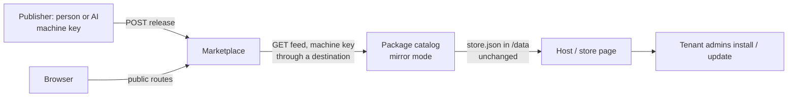

# RFC-0077: Marketplace — Digital Assets with Channels, Visibility and Entitlements, and a Catalog that Mirrors It

- **Status:** **Accepted (2026-11-11)** — D1–D5 decided by Jörg on 2026-11-10
  ("ich bin einverstanden" to the proposal in the conversation), D6–D12 on
  2026-11-11, each as recommended (§14). **Stage 1 built and measured on
  `oaap-test` (2026-11-11, §15.6):** marketplace 0.1.0, package catalog 0.2.0
  (mirror mode), spec `oaap.dist.marketplace` 0.1; M1–M12 green, O2 answered.
  Not yet: the real run (§15.5, oaapx01 → oaapx02) and stages 2–4.
- **Date:** 2026-11-10
- **Authors:** Jörg (the idea: a marketplace / download centre next to the
  package catalog; OAAP apps only one kind of asset; cards, details, images,
  downloads; public by default, visibility for users, machines, groups;
  partners and customers later; channels stable/beta; self-hostable with
  own asset types; external blob storage; web API, MCP, statistics; MVP =
  automated check-in after release, the multi-tenant node takes the current
  versions), Claude (facts read in RFC-0050, the package catalog and the
  node's catalog reader; design)
- **Depends on:** RFC-0050 (package catalog, store source `catalog:`),
  RFC-0012 (store list `0.2`), RFC-0019 (artifact deployment), RFC-0027
  (API keys), RFC-0040 (identity headers), RFC-0007 (visibility groups),
  RFC-0033 / `oaap.net.destinations` (outbound HTTP through the proxy),
  RFC-0068 (closed egress), RFC-0010 (public-route throttling)
- **Related, not decided here:** RFC-0073 (apps as MCP sources, stage 3),
  RFC-0045 (domain permissions, a later home for publisher rights),
  RFC-0057 (database per app), RFC-0049 (update policy on the recipient),
  RFC-0020 (promotion: same bytes), the video service idea (S3-capable
  storage decided before the product)
- **Replaces:** RFC-0050 §5 (stage 3, "supplying recipient nodes from the
  reference node"). The catalog keeps its local role; recipients, tokens per
  recipient and "supply to A, B" move into the marketplace (§2).
- **Idea store:** I-48

## Summary

A **marketplace app** distributes **digital assets** — OAAP app packages
are one asset type among others. Each asset has **releases** (immutable,
content-addressed files) and **channels** (`stable`, `beta`, …) that point
at releases. Whether someone **sees** an asset and whether they may **obtain**
it are two separate questions: an asset is *hidden*, *visible but locked*, or
*obtainable* for a given principal (person, machine, group). An
**entitlement** grants a principal an asset on one or more channels.

Publishers — a person, or an AI with a machine key — **check in** releases
through a web API, the same way the deploy hook takes a package today.
Recipients — usually the **package catalog** of a node — **pull** a feed
that lists exactly what they are entitled to, per channel.

The **node does not change.** The package catalog gains a **mirror mode**: it
fetches the feed through a destination, stores the packages in its own
`/data` with the checks it already makes, and releases them automatically
or holds them for the operator. The host keeps reading the catalog from its
storage (RFC-0050 §7). New work lives in two apps, not in a platform
release.

## 1. What exists today

- **Package catalog** (`oaap-apps/apps/package-catalog` 0.1.1, RFC-0050
  stages 1–2): the operator uploads ZIPs, releases a version, and the
  catalog writes `store.json` (`schema 0.2`, one entry per app: the highest
  released version with `package{zip, sha256, size}`). Only `admin`. It
  reads `oaap-app.yaml` from the ZIP and never unpacks or runs anything.
- **Store source `catalog:<instance>`** (`oaap-reference/platform/services/
  catalog_source.py`): the host reads `store.json` and the ZIPs straight
  from the instance's storage, validates each entry, checks size and
  SHA-256 on a copy it owns, compares id and version with the manifest
  inside. No network, no token.
- **RFC-0050 §5 (stage 3), not built:** recipients registered at the catalog
  with a token each, "supply to A, B", pull. §6.2 already foresaw that a
  local catalog may mirror a central one.
- **How packages travel today:** the ZIP is produced by whoever builds the
  app (for `hbvp`, the hbsha project's own AI), then a person uploads it in
  the catalog of each node (`CURRENT_STATE` 457: `hbvp 0.0.221` on oaapx02).
- **Platform pieces we reuse unchanged:** API keys answer `/verify` like a
  session and give the same headers (RFC-0027); identity headers
  `X-OAAP-User`, `X-OAAP-User-Id`, `X-OAAP-Roles`, `X-OAAP-Groups`,
  `X-OAAP-Display-Name`, `X-OAAP-Email` (RFC-0040, `oaap.core.identity`);
  a `public` route receives no authentication at all (`oaap.core.gateway`,
  RFC-0010 brake); an app reaches another host only through a bound
  destination, `OAAP_DESTINATION_<NEED>_URL`, the proxy adding the
  credential (`oaap.net.destinations` §2.3); an MCP door `mcp: {path}`
  (RFC-0073).

## 2. Two apps, two questions

| | Package catalog (exists) | Marketplace (new) |
|---|---|---|
| Question | What may be installed on **this node**? | Which assets exist, and **who gets which**? |
| Content | OAAP packages only | any asset type; `oaap-app` is one |
| Audience | the node's operator and tenant admins | the public, customers, partners, machines |
| Runs | on every node with tenants | once centrally, or wherever someone wants their own |
| Knows about | the node's store | principals, channels, entitlements — **not** nodes |

The marketplace never addresses a node. A node is a **recipient**: a machine
user of the marketplace's tenant with an API key, entitled to some assets.
The catalog never learns about partners, images or search.



## 3. Model

```text
AssetType   id, name, file rules, metadata fields, validator (built-in name)
Asset       id (slug), type, title, summary, description (Markdown),
            icon, screenshots[], tags[], categories[], links[],
            license, publisher, visibility, created_at
Release     asset, version, notes (Markdown), files[], created_at, by,
            yanked{at, by, reason}?
File        sha256 (the key), size, name, media type, role (primary | extra)
Channel     asset-independent name: stable, beta, … (configurable)
Placement   release × channel, placed_at, by        — "this release is in beta"
Principal   user id | group | anyone | signed-in
Visibility  per asset: listed (anyone | signed-in | principals) — see §5
Entitlement principal × asset × channels[], granted_by, granted_at,
            expires_at?, note
Event       download | feed poll | publish | place | yank | grant | revoke
```

Rules:

- **A release is immutable.** Same asset + version with the same bytes is
  idempotent (`200`, existing release); with different bytes it is refused
  (`409`). A version is never reused, not even after a yank.
- **Files are content-addressed.** The blob key is the SHA-256; two releases
  with the same file store it once.
- **A channel is a set of placements, not a copy.** "Promote beta to
  stable" places the same release in `stable` — the same bytes, as in
  RFC-0020. The channel's current release is the **highest non-yanked
  version placed in it** (ordering as the catalog's `version_key`: numeric,
  `1.2.10` after `1.2.9`, `1.0.0` after `1.0.0-rc1`).
- **Rollback = yank** (with a reason, kept in the event log). The channel
  then falls back to the next highest release. Already-installed instances
  are untouched; the recipient decides (§7.4).
- **History is always kept** (Jörg: optional in the UI). Stage 1 stores it;
  stage 2 shows it.

## 4. Asset types

- Stage 1 ships two **built-in** types:
  - `oaap-app`: exactly one primary file, a ZIP. Validator `oaap-manifest`:
    the same checks as the catalog's `zipinfo.py` (no `..`, no absolute
    paths, no links, a valid `oaap-app.yaml`, version `x.y.z[-pre]`), and
    **asset id = `app.id`, release version = `app.version`** from the
    manifest. Nothing is unpacked or run.
  - `file`: one or more files, extensions and size from configuration, no
    validator beyond size and name.
- Stage 4 makes types **configurable by the marketplace admin**: a list of
  metadata fields (text, Markdown, URL, number, select, tags), allowed
  extensions, maximum size, and a validator **chosen from the built-in
  list** (`none`, `oaap-manifest`, later e.g. `pdf`). **No uploaded code ever
  becomes a validator.** A self-hosted marketplace without OAAP apps simply
  never enables `oaap-app`.

## 5. Visibility and entitlement — seeing is not obtaining

For one principal and one asset there are three states:

| State | Listed and searchable | Detail page | Download / in the feed |
|---|---|---|---|
| hidden | no | `404` | no |
| visible, locked | yes, marked "freischalten" | yes | no — "request access" |
| obtainable | yes | yes | yes, on the entitled channels |

- **Visibility** (per asset): `anyone` | `signed-in` | a list of principals
  (user ids, groups). Default for a new asset: see D11.
- **Obtainable** if the asset is **free** for its visibility audience
  (`free: true` per asset and channel set, e.g. "stable is free, beta is
  not") **or** the principal holds an **entitlement** covering the channel.
- **Groups** are the `X-OAAP-Groups` of the marketplace's own tenant
  (RFC-0007 tags, or Keycloak groups when the tenant uses the IdP). A
  machine user can be in groups like a person.
- **Every read path filters before it counts or ranks** — search, card
  lists, facets, MCP, statistics shown to non-admins. A hidden asset must not
  even change a number.
- **Request access** (stage 2): a signed-in principal asks; the request
  lands in the admin's list (later: a Vorgang, RFC-0061); granting creates
  an entitlement.
- **Partners** (stage 4): a partner is a group with a delegation: its
  members may grant and revoke entitlements for named assets, but only to
  principals in their customer groups. The marketplace admin defines the
  delegation; the partner never widens visibility.

## 6. Publishing — the check-in

All under `/api/v1/` (non-public route: session or API key).

| Method and path | Does |
|---|---|
| `POST /api/v1/releases` | multipart: `file` (primary), optional `extra` files, `type` (default `oaap-app`), `notes`, `channels` (comma list). For `oaap-app` the asset is created on first check-in from the manifest if the caller may publish into that id. Answer: asset, version, sha256, placements. |
| `POST /api/v1/assets/{id}/releases/{v}/channels/{ch}` | place a release in a channel |
| `DELETE /api/v1/assets/{id}/releases/{v}/channels/{ch}` | remove a placement |
| `POST /api/v1/assets/{id}/releases/{v}/yank` | yank, `reason` required |
| `PUT /api/v1/assets/{id}` | metadata (title, summary, description, tags, links, visibility, free) |
| `POST /api/v1/assets/{id}/images` | icon or screenshot (raster only, §12) |

- **Who may publish:** a publisher right per asset id or id prefix
  (`hbvp`, `oaap-*`), held by user ids or groups, granted by the
  marketplace admin. Stage 1 keeps this in the app (D8). The right may be
  limited to channels (e.g. an AI key may place into `beta` and `stable`,
  a trainee only into `beta`).
- **The "after release" rule stays with the human, upstream.** Jörg releases
  on oaap-test (test instance, promotion); the check-in that follows is
  automated. The marketplace does not try to judge quality. Whoever wants a
  second gate publishes into `beta` and places into `stable` by hand.
- **A small client** `oaap-apps/apps/marketplace/tools/publish.py`
  (stdlib only) takes `--url`, `--key-file` (never the key on the command
  line), the ZIP and `--channels`, and prints the answer. This is what an
  AI or a CI job calls.

## 7. The feed and the catalog's mirror mode

### 7.1 Feed

`GET /feed/v1/oaap-apps?channel=stable` (non-public route; the caller is a
machine user via API key):

```json
{
  "schema": "oaap.marketplace.feed/0.1",
  "name": "OAAP Marketplace",
  "channel": "stable",
  "generated_at": "2026-11-10T12:00:00Z",
  "apps": [
    {"id": "hbvp", "name": "Handball-Vereinsportal", "version": "0.0.221",
     "released": "2026-11-09", "summary": "…", "description": "…",
     "package": {"url": "files/3f2a…e9", "sha256": "3f2a…e9", "size": 1834221}}
  ],
  "withdrawn": [{"id": "hbvp", "version": "0.0.220", "reason": "…"}]
}
```

- One entry per **obtainable** OAAP app: the channel's current release.
  The fields mirror `store.json` (RFC-0012 `0.2`) so the catalog maps them
  one to one; `package.url` is relative to the feed.
- `withdrawn` lists yanked versions the caller was offered before (so the
  mirror can react, §7.4).
- `GET /feed/v1/files/{sha256}` serves the file to the same caller, again
  only if obtainable. `ETag` = sha256; `If-None-Match` on the feed itself
  makes polling cheap.
- The **node's store format does not change.** The feed is the marketplace's
  own format; only the catalog reads it.
- A generic `GET /feed/v1/assets?type=…&channel=…` for other asset types is
  stage 3.

### 7.2 Mirror mode in the package catalog (0.2.0)

- Manifest gains a destination need:
  `destinations: [{name: upstream, kind: http, purpose: "Marketplace feed (RFC-0077)"}]`.
  The operator binds it to a destination with **bearer auth = the machine
  key**; the key lives in the destination, never in the catalog's
  configuration or storage (`oaap.net.destinations`).
- New configuration:

  | Key | Meaning | Default |
  |---|---|---|
  | `CATALOG_UPSTREAM_CHANNEL` | channel to follow | `stable` |
  | `CATALOG_UPSTREAM_RELEASE` | `auto` = release on arrival; `hold` = operator releases | `auto` (D3) |
  | `CATALOG_UPSTREAM_INTERVAL_MIN` | polling interval | `15` |

- Without a bound `upstream` the catalog behaves exactly as 0.1.1.
- Each poll: `GET feed` (conditional), for every entry whose version the
  catalog does not hold: download to its `tmp`, check size and SHA-256
  against the feed, then hand it to the **existing `add()`** (all current
  rules apply: manifest, paths, version, id) — `by: "upstream"`, note
  `"from <feed name>, channel <ch>"`. With `auto` it then calls
  `set_released(…, True, "upstream")`, which rewrites `store.json`.
- The catalog page shows the mirror: feed name, channel, last poll, last
  error, versions taken; a button "Jetzt abrufen" (admin only).
- Uploading by hand keeps working beside the mirror. A version that exists
  locally is never overwritten by the mirror (same rule as today).

### 7.3 Why the catalog in between (D2)

1. No platform release: the host already reads the catalog from storage.
2. The operator keeps a gate (`hold`, RFC-0050 §6.3).
3. Pull, not push: the marketplace holds no access to nodes and learns
   "node X fetched version Y at time T" without telemetry.
4. Closed tenants (RFC-0068) are served: the destination is the sanctioned
   door out.

### 7.4 Withdrawn upstream

Proposed (D7): with `auto`, a withdrawn version that is released locally is
**unreleased** with the reason in the catalog's audit log; instances that
run it are not touched, and the store page then offers the next highest
released version. With `hold`, the catalog only marks it. Deleting stays a
human act.

## 8. The web interface

Routes in the manifest:

| Path | Route | For |
|---|---|---|
| `/`, `/assets/*`, `/static/*`, `/img/*` | `public` | browsing what `anyone` may see; public downloads under `/d/*` |
| `/my/*` | `user` | the same pages signed in: more visible, entitlements, requests |
| `/api/public/v1/*` | `public` | read-only JSON of what `anyone` may see |
| `/api/v1/*` | `user` | search, details, downloads, publishing (§6), keys welcome |
| `/feed/v1/*` | `user` | recipients (§7) |
| `/admin/*` | `admin` | types, channels, publishers, visibility, entitlements, requests, statistics |
| `/mcp` | MCP door (RFC-0073) | stage 3 |

A public route carries no identity, so "signed-in view" is a second path
prefix serving the same templates with the headers — a link "Anmelden" goes
from `/x` to `/my/x`.

- **Search page:** a search field, facets (type, category, tag, channel),
  cards with icon, title, summary, publisher, latest version, a badge
  (free / locked / entitled / beta). Server-side search in SQLite FTS5.
- **Detail page:** header with icon and actions (Download, Request access),
  screenshot gallery, description in Markdown (escaped first, a few marks
  after — as the chat's `markdown.js`), facts (version per channel, size,
  licence, links, publisher), release history with notes (stage 2).
- Design per the OAAP design guidelines (blue tones, floorplans: list
  report = search, object page = detail), tablet first, dark mode.

## 9. Storage

- A small interface `BlobStore`: `put(stream) -> sha256, size`,
  `open(sha256)`, `stat(sha256)`, `delete(sha256)` (only when no release and
  no image references it).
- Stage 1: **local** in `/data/blobs/ab/cd/<sha256>`; metadata in SQLite
  `/data/market.db` (WAL). Both in the instance's storage, so the node's
  backup carries them.
- Stage 3: **S3-compatible** behind the same interface, chosen per
  instance. Open question O1: S3 requests are signed (SigV4) over the host
  name, so they cannot simply go through the destination proxy, which
  changes the host and adds its own credential. Options: a `tcp`-style
  destination that hands the app endpoint and keys; or presigned URLs made
  by the app and fetched by the client directly. To be measured before
  stage 3 is designed in detail. **Data in S3 is not in the node's
  backup**; the admin page says so.
- Downloads go through the app in stages 1–2 (statistics, entitlement
  check on every request). Presigned direct links are a stage-3 option for
  large public files.

## 10. MCP (stage 3)

Through RFC-0073, read first: `search_assets`, `get_asset`,
`list_releases`, `my_entitlements`. Writing tools (`place_release`,
`grant_entitlement`) only later and only with the chat's confirmation
(RFC-0074/0075). Every tool applies §5 before it answers.

## 11. Statistics

- Downloads per asset, version, channel, day; per principal for admins and
  (stage 4) for the partner of that principal. **No IP addresses are
  stored**; anonymous downloads count as "anonymous".
- Recipients: last feed poll, versions offered, files fetched. This is
  "**offered and fetched**", not "installed" — the page says so.
- Publishers see their own assets' numbers.

## 12. Security

- Nothing uploaded is ever executed, unpacked to disk or rendered as
  active content. ZIPs are inspected in memory (as `zipinfo.py`).
- **Images:** PNG, JPEG, WebP only (magic bytes checked, not the name), size
  limit, served with `X-Content-Type-Options: nosniff` and a strict CSP.
  **No SVG.**
- **Downloads:** `Content-Disposition: attachment`, `application/octet-stream`
  unless the type is on a short safe list.
- **Hidden means `404`**, never `403`.
- Keys are platform API keys (D10); the app never sees a secret and logs
  no query strings (as the catalog: no request lines).
- Cross-site POSTs refused as in the catalog (`Origin`/`Sec-Fetch-Site`).
- **Trust of a package:** SHA-256 and TLS prove the file is what the
  marketplace offers, not who made it. That is enough while the marketplace
  and the publisher are the same operator. With third-party publishers,
  **signatures** (stage 4: publisher key, Ed25519 over the file's SHA-256,
  verified by the catalog and later by the node) become necessary.
- Public routes are throttled by the platform (RFC-0010).

## 13. Stages

| Stage | Content | Done when |
|---|---|---|
| **1 — MVP** | marketplace 0.1: SQLite, local blobs, types `oaap-app` + `file`, publish API + `publish.py`, channels `stable`/`beta`, yank, visibility + entitlements (user, group), feed + files, a plain admin page; **package catalog 0.2.0 mirror mode** | M1–M12 (§15.4) green on oaap-test; then a real run: release on oaap-test → check-in → oaapx02's catalog has it → a tenant admin updates |
| 2 — Store front | search with cards and facets, detail page with gallery, release history, the three states visible, request access, images | Jörg's browser test |
| 3 — Services | S3 (after O1 is measured), MCP door, statistics pages, generic feed | measured per piece |
| 4 — Partners | partner delegation, configurable asset types, signatures | per decision |

## 14. Decisions

Decided by Jörg on 2026-11-10:

- **D1 — An app of its own, generic assets.** Not an extension of the
  package catalog; `oaap-app` is one asset type.
- **D2 — The catalog stays in between.** Nodes take packages through the
  package catalog in mirror mode; the host is unchanged.
- **D3 — Mirrored versions are released automatically by default,**
  configurable per catalog (`auto` | `hold`).
- **D4 — No payment or licensing in this RFC.** The model leaves room (an
  entitlement can later carry an origin such as an order).
- **D5 — Name: Marketplace**, app id `marketplace`.

Decided by Jörg on 2026-11-11, each as recommended:

- **D6 — The productive marketplace runs on oaapx01** (public name, TLS,
  off-site backup), in Jörg's own tenant; oaap-test stays the measuring
  ground.
- **D7 — Withdrawn upstream → unreleased locally with `auto`** (§7.4),
  never deleted, instances untouched.
- **D8 — Publisher rights in the app for stage 1;** moving them to
  RFC-0045 (domain permissions) when that has a second user.
- **D9 — SQLite in the instance's storage;** RFC-0057 only when a measured
  need shows up.
- **D10 — Platform API keys of machine users for recipients and AI
  publishers;** no own token scheme in the app. Rotation and revocation
  happen in the portal ("Zugänge").
- **D11 — A new asset starts "visible, locked"** (listed for `anyone`,
  obtainable only with an entitlement). Free download is an explicit
  switch per asset. Reason: an OAAP package is code; making it freely
  downloadable should be a decision, not a default.
- **D12 — Channels are global names** (`stable`, `beta` preset, more
  configurable), not per asset.

Open questions:

- **O1** — S3 through the destination proxy or with handed-over
  credentials (§9).
- **O2** — Does the destination proxy carry 256 MB downloads within its
  limits and timeouts? Measured in stage 1 (M10).
- **O3** — Should the catalog report back what was *installed* (not only
  fetched)? Not now; it would be telemetry from the node and needs its own
  decision.

## 15. Implementation plan

### 15.1 Repositories and files

- `oaap-apps/apps/marketplace/` (new): `oaap-app.yaml` (manifest 0.13,
  routes §8, storage `data`, config below, health `/healthz`),
  `Dockerfile` (python:3.12-slim, stdlib only as far as possible),
  `app.py` (HTTP server and routing, as the catalog), `db.py` (schema,
  migrations by `user_version`), `blobs.py` (`BlobStore`, local),
  `access.py` (§5 in **one** function `can(principal, asset, action,
  channel)` — every path calls it, see "Zwei Wege, eine Regel"),
  `zipinfo.py` (copied from the catalog, same tests), `feed.py`,
  `publish.py` handlers, `templates/`, `static/`, `tools/publish.py`,
  `test_marketplace.py`, `README.md` (German).
- `oaap-apps/apps/package-catalog/`: 0.2.0 — `upstream.py` (poll, download,
  verify, hand to `add()`), the destination need and three config keys,
  status block on the page, tests with a fake feed served by a local
  `http.server`.
- Store list of `oaap-apps`: both entries (version in three places, checked
  by `check-store.py`).
- `oaap-spec/spec/oaap.dist.marketplace.md` 0.1 (new capability spec: model,
  §5 rules, API, feed format) — written with stage 1, from this RFC.
- `oaap-spec/spec/oaap.apps.runtime.md`: one paragraph at the catalog
  section (mirror mode), no change to the host.
- `oaap-lab/marketplace-probe/`: the measuring script (§15.4).

### 15.2 Configuration of the marketplace

| Key | Meaning | Default |
|---|---|---|
| `MARKET_NAME` | shown in the header and the feed | `Marketplace` |
| `MARKET_MAX_FILE_MB` | largest file | `256` |
| `MARKET_CHANNELS` | channel names | `stable,beta` |
| `MARKET_TYPES` | enabled built-in types | `oaap-app,file` |
| `MARKET_FILE_EXTENSIONS` | allowed for type `file` | `zip,pdf,png,jpg,txt,md` |

### 15.3 SQLite schema (stage 1)

```sql
asset(id TEXT PK, type, title, summary, description, visibility TEXT,  -- JSON
      free_channels TEXT, created_at, created_by)
release(asset, version, notes, created_at, created_by,
        yanked_at, yanked_by, yank_reason, PRIMARY KEY(asset, version))
file(sha256 PK, size, media_type)
release_file(asset, version, sha256, name, role)
placement(asset, version, channel, placed_at, placed_by,
          PRIMARY KEY(asset, version, channel))
entitlement(id PK, principal_kind, principal, asset, channels, granted_by,
            granted_at, expires_at, note)
publisher(id PK, principal_kind, principal, asset_pattern, channels)
event(id PK, at, kind, asset, version, channel, principal, detail)
```

### 15.4 Measurements for stage 1 (oaap-test)

Setup: marketplace instance `market-test` in tenant A; a machine user
`node-b` with an API key; a package catalog in tenant B with destination
`upstream` → `market-test`, bearer = that key; a publisher machine user
`ci` with an API key.

- **M1** `publish.py` with `ci` checks in `probe-app 0.1.0` into `beta`:
  `201`, sha256 matches the local file.
- **M2** Same file again: `200`, same release; changed bytes, same version:
  `409`.
- **M3** A ZIP with `../x`, a link, no manifest, version `1.0`: each refused
  with a sentence, nothing stored.
- **M4** `ci` without a publisher right for `other-*`: `403`.
- **M5** `node-b` without entitlement: the feed omits the app; the detail
  page as `anyone` shows it "locked"; the file URL answers `404`.
- **M6** Entitlement `node-b` × `probe-app` × `stable`; release only in
  `beta`: feed empty. Place in `stable`: feed lists `0.1.0`.
- **M7** Mirror: within one interval (or "Jetzt abrufen") the catalog holds
  `0.1.0`, released (`auto`), `store.json` lists it; the store page of
  tenant B offers it after the state refresh. Install works (host checks
  sha256 on its copy).
- **M8** Check in `0.1.1` into `stable`: the store page offers
  "Update to 0.1.1"; the update runs.
- **M9** Yank `0.1.1` with a reason: feed lists it under `withdrawn`; the
  catalog unreleases it (`auto`), audit line names the reason; the running
  instance stays on `0.1.1`; the store page offers nothing higher than
  `0.1.0`.
- **M10** A 200 MB package through the destination proxy (O2): time, memory
  of the catalog, no partial file left on failure.
- **M11** `hold`: a new version arrives unreleased; the operator releases it
  by hand.
- **M12** Hidden asset: `anyone` gets `404` on detail and download, the
  search count does not change, `/api/public/v1` does not list it.

### 15.5 After stage 1 — the real run

Marketplace on oaapx01 (D6), machine user for oaapx02, destination in
oaapx02's catalog. The next release of `hbvp` goes the new way: released on
the development side, checked in by `publish.py`, mirrored into oaapx02's
catalog, updated by a tenant admin of a club. Manual uploads on oaapx02 then
stop for that app.

### 15.6 Stage 1 as built (2026-11-11)

`oaap-apps/apps/marketplace` 0.1.0 (`app.py`, `db.py`, `access.py` -- the one
rule --, `blobs.py`, `zipinfo.py`/`multipart.py` copied from the catalog,
`tools/publish.py`, `test_marketplace.py` 46/46) and
`oaap-apps/apps/package-catalog` 0.2.0 (`upstream.py`, `test_upstream.py`
19/19 against the real marketplace in-process, old tests green). Where the
build sharpened the text:

- **Principals are user names** (`X-OAAP-User`) and groups (`X-OAAP-Groups`)
  in stage 1, not user ids: an operator types a name into the admin page. A
  machine user's name does not change; RFC-0040's id becomes the key when a
  partner UI (stage 4) picks principals from a list.
- **A yanked release is never placed again** (`409` with a sentence), also
  not by checking the same file in again.
- **The mirror checks id and version against the manifest inside the ZIP
  before `add()`**, not after: otherwise a package that is something else
  than the feed claims would land in the catalog under its own name. A
  `package.url` that is not `files/<sha256>` is refused (it would lead past
  the destination).
- `/admin` answers `404` to a non-operator, like a hidden asset.
- Search in stage 1 is a substring over id, title and summary; FTS5 comes
  with the store front (stage 2).

**Measured on `oaap-test` (2026-11-11)** with machine users `m77-ci`
(publisher right `probe-*`) and `m77-node-b` (keys limited to the instance,
7 days), marketplace `market-test` in the default tenant, catalog
`katalog-probe` in tenant `zzz-probe`, destination `market-upstream` →
`http://10.10.10.96:8134` (the node's own LAN address and the instance's
port: the node cannot reach its own public name, and the gateway accepted
the call to its own port), bearer = `m77-node-b`'s key:

- **M1** `publish.py` → `201`, SHA-256 equal, placed in `beta`. **M2** again
  `200`/not created; other bytes `409`. **M3** `../x`, no manifest, `1.0`
  each refused with a sentence, nothing stored. **M4** `other-app` → `403`.
- **M5** feed empty, public detail page "freischalten", file `404` both ways.
  **M6** entitlement for `stable` with the release in `beta` only → feed
  empty; placed in `stable` → feed lists `0.1.0`.
- **M7** "Jetzt abrufen" in the catalog: fetched through the destination,
  `0.1.0` released (`auto`); `oaap store add-catalog`; installed from the
  portal's store as `server_admin` → instance `marktprobe` 0.1.0 runs.
- **M8** `0.1.1` into `stable` → mirrored and released → portal update →
  the instance runs `0.1.1`.
- **M9** yank `0.1.1` ("Messung M9") → feed lists it under `withdrawn`;
  the catalog unreleased it (`withdraw` by `upstream`, reason in the audit
  log, version kept), `store.json` offers `0.1.0`, the instance stays on
  `0.1.1`.
- **M10 / O2** a 209,716,015-byte package: check-in from a laptop in 14 s,
  mirrored through the destination proxy in 3 s, SHA-256 equal, no file left
  in the catalog's `tmp`, catalog at 23 MiB memory (streamed). *Not*
  measured live: a download broken off half way (covered by the unit test's
  clean-up path only).
- **M11** `CATALOG_UPSTREAM_RELEASE=hold` → `0.1.2` arrived unreleased;
  released by hand → `store.json` lists `0.1.2`.
- **M12** visibility `principals` → public list count `0`, detail `404`, the
  entitled machine keeps its feed; back to `anyone` → count `1`.

**Left on `oaap-test` for stage 2:** `market-test`, `katalog-probe`,
`marktprobe`, the two machine users and their keys (expire 2026-11-18), the
catalog store source.

---

## Deutsche Zusammenfassung (für Jörg)

**Worum es geht:** Eine neue App **Marketplace** verteilt digitale Assets.
OAAP-Apps sind ein Asset-Typ unter mehreren. Ein Asset hat **Releases**
(unveränderlich, Dateien über ihren SHA-256 abgelegt) und **Kanäle**
(`stable`, `beta`, …). Ein Kanal ist nur ein Zeiger auf Releases: Was in
Beta gut war, wird in Stable „hineingelegt“, mit denselben Bytes. Rückruf
heißt „zurückziehen“ (mit Grund). Der Kanal fällt dann auf das nächstniedrige
Release zurück.

**Sehen ist nicht Bekommen:** Ein Asset ist für jemanden *verborgen*
(Antwort 404), *sichtbar, aber gesperrt* („freischalten“) oder *beziehbar*.
Beziehbar ist es, wenn es frei ist oder eine **Berechtigung** (Person,
Maschine oder Gruppe × Asset × Kanäle) besteht. Suche, Zahlen und MCP
filtern, *bevor* gezählt wird. Partner dürfen später Berechtigungen für ihre
Kunden vergeben, aber nie die Sichtbarkeit erweitern.

**Einchecken:** Nach deiner Freigabe auf oaap-test lädt eine KI oder ein
Skript (`tools/publish.py`) das Paket mit einem Maschinenschlüssel per API
hoch, direkt in den gewünschten Kanal. Dieselbe Version mit anderen Bytes
wird abgelehnt.

**Beziehen, ohne den Knoten zu ändern:** Der **Paketkatalog** bekommt einen
**Spiegelmodus**. Über eine Destination (der Maschinenschlüssel liegt dort,
nicht im Katalog) holt er alle 15 Minuten den Feed, prüft Größe und
SHA-256, nimmt das Paket mit seinen bisherigen Regeln auf und gibt es frei
(Standard „auto“, wahlweise „hold“). Der Knoten liest den Katalog weiter wie
bisher. Es braucht also **kein Plattform-Release**. Zurückgezogene Versionen
nimmt der Katalog aus der Freigabe, laufende Instanzen bleiben unberührt.
Stufe 3 von RFC-0050 (Empfänger im Katalog) entfällt damit, der Marketplace
übernimmt sie.

**Oberfläche:** Öffentlich unter `/` (ohne Anmeldung), angemeldet unter
`/my/` (eine öffentliche Route kennt keine Identität). Suche mit Cards und
Facetten, Detailseite mit Bildern, Markdown, Versionen je Kanal und
Verlauf. Bilder nur PNG/JPEG/WebP, kein SVG.

**Ablage:** Zuerst lokal im Speicher der Instanz, damit das Backup sie
trägt. Später S3-kompatibel. Offene Frage O1: S3-Anfragen sind signiert und
passen nicht einfach durch den Destination-Proxy. Das messen wir vor Stufe 3.

**Stufen:** (1) MVP: API, Kanäle, Berechtigungen, Feed, Spiegelmodus,
gemessen mit M1–M12 auf oaap-test, danach echt mit hbvp von oaapx01 nach
oaapx02. (2) Schaufenster mit Cards, Details und Freischalt-Anfragen.
(3) S3, MCP, Statistiken. (4) Partner, eigene Asset-Typen, Signaturen.

**Entschieden (10.11.):** D1 eigene App, D2 Katalog dazwischen, D3
automatische Freigabe als Standard, D4 kein Geld, D5 Name Marketplace.
**Entschieden (11.11., alle wie empfohlen):** D6 produktiv auf oaapx01 (in
deinem Mandanten, oaap-test bleibt Messfeld), D7 Zurückgezogenes wird lokal
aus der Freigabe genommen (nie gelöscht, Instanzen unberührt), D8 Rechte
zum Veröffentlichen zunächst in der App, D9 SQLite im Speicher der Instanz,
D10 Plattform-API-Schlüssel von Maschinenbenutzern, D11 ein neues Asset
startet „sichtbar, gesperrt“, D12 Kanäle sind globale Namen. **Damit
Accepted; Stufe 1 wird gebaut.**

**Stufe 1 gebaut und gemessen (11.11., §15.6):** Marketplace 0.1.0 und
Paketkatalog 0.2.0 mit Spiegelmodus, Spec `oaap.dist.marketplace` 0.1.
Auf oaap-test lief der ganze Weg einmal echt durch: Einchecken mit
`publish.py`, die Berechtigung, der Katalog holt über die Destination, die
App aus dem Store installiert, Update, Rückruf (der Katalog nimmt die
Version aus der Freigabe, die Instanz bleibt) und `hold`. M1–M12 sind grün.
Ein 200-MB-Paket ging in 3 s durch den Proxy (O2 beantwortet). Nächster
Schritt ist der echte Lauf: Marketplace auf oaapx01, Katalog auf oaapx02,
hbvp auf dem neuen Weg. Das nur auf dein Wort.
